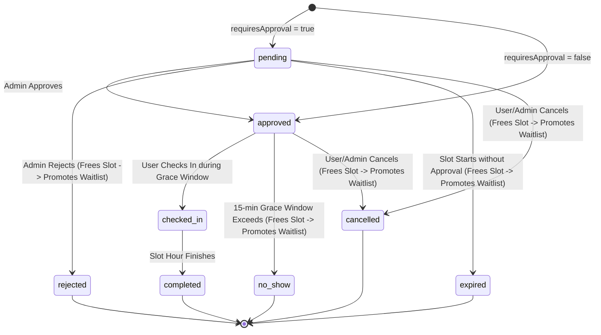

# SlotSync Architecture & System Design

SlotSync is an enterprise-grade, race-condition safe Campus Room & Lab Booking System built on the MERN stack with strict Asia/Kolkata (IST) timezone invariants, optimistic concurrency safety via MongoDB partial unique indexes, an automated FIFO waitlist, real-time Socket.IO synchronization, and an administrative approval workflow.

---

## 1. System Architecture Overview

```
                                      +------------------------+
                                      |   React SPA (Vite)     |
                                      | Tailwind + Redux + RTK |
                                      +-----------+------------+
                                                  |
                                   HTTP / REST    |   WebSocket (Socket.IO)
                                  (Credentials)   |  (Availability / Notifs)
                                                  v
                                      +------------------------+
                                      | Express.js Application |
                                      |  Node.js (Asia/Kolkata)|
                                      +-----------+------------+
                                                  |
                    +-----------------------------+-----------------------------+
                    |                             |                             |
                    v                             v                             v
          +-------------------+         +-------------------+         +-------------------+
          |  Booking Engine   |         | Waitlist Engine   |         | No-Show Scheduler |
          |  Atomic Validate  |         | FIFO Promotion    |         | 1-Min Cron + Lazy |
          +---------+---------+         +---------+---------+         +---------+---------+
                    |                             |                             |
                    +-----------------------------+-----------------------------+
                                                  |
                                                  v
                                      +------------------------+
                                      |   MongoDB Database     |
                                      | Partial Unique Indexes |
                                      +------------------------+
```

---

## 2. Concurrency Safety & Race-Condition Architecture

The defining technical challenge in campus room booking is simultaneous reservation of high-demand rooms. Conventional check-then-insert code paths suffer from Race Conditions (TOCTOU: Time of Check to Time of Use).

### Partial Unique Compound Index Invariant
SlotSync delegates concurrency guarantees directly to the database engine using partial unique compound indexes:

1. **Room Slot Uniqueness**:
   ```javascript
   { room: 1, date: 1, slot: 1 }
   partialFilterExpression: { holdsSlot: true }
   name: "uniq_active_room_slot"
   ```
2. **User Slot Double-Booking Prevention**:
   ```javascript
   { user: 1, date: 1, slot: 1 }
   partialFilterExpression: { holdsSlot: true }
   name: "uniq_active_user_slot"
   ```

### Execution Flow Under 10-User Concurrency
When 10 users click "Book" for the same room and slot at the exact same millisecond:
1. All 10 requests reach `POST /api/bookings`.
2. Mongo engine atomically accepts the first write and marks `holdsSlot: true`.
3. The remaining 9 inserts violate the partial unique index, triggering Mongo error code `11000 (DuplicateKey)`.
4. The service catches `11000` and immediately responds with `409 Conflict` (`SLOT_TAKEN`), offering an immediate one-click "Join Waitlist" action.
5. Zero corrupt duplicate bookings can ever occur.

---

## 3. Booking Lifecycle & Finite State Machine (FSM)

Every booking status transition is governed by strict atomic state transitions using `Booking.findOneAndUpdate({ _id, status: fromStatus }, { $set: { status: toStatus, holdsSlot: ... } }, { new: true })`.



### HoldsSlot Matrix
| Status | `holdsSlot` | Slot Occupied in Grid? | Waitlist Action on Transition? |
| :--- | :---: | :---: | :---: |
| `pending` | `true` | Yes | No |
| `approved` | `true` | Yes | No |
| `checked_in` | `true` | Yes | No |
| `completed` | `false` | No (past) | No |
| `rejected` | `false` | No (freed) | Auto-promote FIFO Waitlist |
| `cancelled` | `false` | No (freed) | Auto-promote FIFO Waitlist |
| `expired` | `false` | No (freed) | Auto-promote FIFO Waitlist |
| `no_show` | `false` | No (freed) | Auto-promote FIFO Waitlist |

---

## 4. FIFO Waitlist Auto-Promotion Engine

When a room is booked, additional users can queue up in a FIFO waitlist ordered by `createdAt ASC`.

Whenever an active booking transitions to a non-holding state (`cancelled`, `rejected`, `no_show`, `expired`):
1. The system calls `waitlistService.promoteNext(roomId, date, slot)`.
2. Queries the oldest waiting user for that slot.
3. Automatically promotes them to a reservation using the unified `createBooking` engine.
4. If the room is unrestricted, the promoted booking is immediately `approved` with a 15-minute check-in deadline.
5. Broadcasts real-time events via Socket.IO to notify the user and refresh the live availability grid across all connected clients.

---

## 5. Free-Tier Resiliency: Hybrid Scheduler & Lazy Reconcile

Because cloud deployment platforms (like Render free tier) spin down dynos when idle:
- A pure `node-cron` scheduler may miss jobs if the instance was sleeping during a 10:00 AM slot.
- **Solution**: SlotSync implements an idempotent `reconcile(now)` function:
  1. Executes on every server boot (`src/index.js`).
  2. Executes every 60 seconds via `node-cron`.
  3. Executes lazily at the start of `GET /api/rooms/availability` (throttled to once every 20 seconds).
- Any no-shows or expired pending requests are instantly reconciled whenever anyone interacts with the server, even if the server was asleep for hours.
